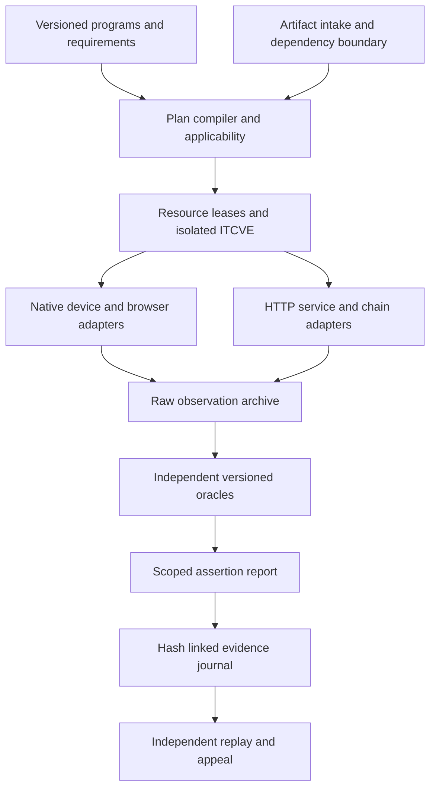

# Laboratory architecture

The orchestration control plane is outside SUT networks. It allocates disposable device guests and service namespaces, stages verified artifacts, restores initial state, drives public interfaces, records observations, evaluates criteria, and publishes only after evidence verification. Adapters execute lifecycle operations and preserve raw observations. Independent oracles determine conformance.

ITCVE-1 supplies the complete component graph. ISI-1 selects a full integration profile; ISI-2 through ISI-4 select smaller closures of that graph. ITCVE-2 adds a multicast delivery fabric between the same services for ISI-5. A service can be the SUT in one run and a pinned supporting component in another. The run manifest records each role distinctly. All components are replaceable by an implementation that satisfies the declared interface and admission contract; the coordinator is not tied to an SDK language.

## Boundaries

1. Intake records submitted bytes, source/release provenance when available, license/redistribution terms, signature verification, architecture, configuration, and dependencies.
2. Planning expands required vectors and matrix cells, verifies closure and capabilities, assigns resource leases, and refuses unresolved mandatory interpretations.
3. Execution follows the selected environment profile and declared service schedule. Readiness is semantic (expected chain/state), not merely an open port.
4. Observation captures raw protocol and state evidence with causal identifiers before projection.
5. Evaluation uses versioned independent predicates and predeclared applicability.
6. Publication preserves failed and blocked attempts and requires verified evidence, recorded permissions and an accessible reproduction bundle under the [intake process](intake.md#public-result-admission). Certification follows a separately established program.

## Sharing efficiently

The coordinator deduplicates immutable image layers and fixture blobs and reuses OS base snapshots after verified reset. Native device leases are exclusive. Each matrix cell has separate wallet identities, permissions, browser profiles, chain state, and content roots. Shared interoperability topologies form a single recorded run with one event schedule. Resource sharing preserves evidence independence and result scope.

## Implementation strategy

The dependency-free Node core establishes machine-readable contracts and evidence mechanics. Wire protocols and JSON artifacts remain language-neutral. TypeScript and Go adapters can consume the same program definitions, but imported SDK-level vectors are reviewed for licenses, semantics, independent oracles, and complete HTTP/native coverage before being credited. HTTP drivers, controlled-service orchestration, native automation, and content acquisition are separate modules with their own conformance tests and qualification gates.

ISI-1 implements this separation as a TypeScript reference protocol package, a digest-pinned Teranode Compose runtime, and source-pinned component plans. The component runner applies declared environment adapters to a disposable source archive, executes an argument-vector command without a shell, and records the exact inputs and output. The joined transaction-services profile retains one causal transaction identity from Broadcaster receipt through Teranode mining and Merkle proof validation. [ISI-1 decision 0002](../programs/ISI-1/decisions/0002-executable-profiles.md) defines the resulting claim boundary.

## Deployment model

The laboratory is a portable protocol rather than a hosted service. The repository-owned controller, plans, adapters, and oracles run from an operator terminal or a CI scheduler without changing their semantics. Docker Compose is the baseline service-topology representation for single-host and independent reproduction. Kubernetes may implement the same topology when concurrency or integrated-stack capacity requires it; no result depends on Kubernetes-specific behavior unless the selected profile declares that behavior.

Native applications run in disposable guests or declared physical devices. A clean base is acquired and qualified separately, identified by digest and platform metadata, and cloned for each execution. The control plane stages only the run inputs, leases the complete topology, collects evidence, and tears down the clone. Repository, archive, and CI credentials do not enter the SUT guest.

GitHub Actions performs source checks and may schedule qualified capacity. Hosted runners are not historical native environments: their image contents change and their retained artifacts expire. TPNIL therefore records the observed runner image, stores durable evidence in the laboratory archive and Git history according to size, and supports the same run from an independent local installation.

Android jobs can run on a local SDK/AVD or the repository-scoped `tpnil-android-qa` KVM runner. The runner is scheduling capacity rather than a trusted oracle: repository plans create the AVD, derive installable artifacts from pinned inputs, drive public interfaces, capture device state, and produce evidence that the offline verifier checks. Chromium extension runs use the same principle on a fresh persistent context with a blocked-egress controlled-service boundary.

Every evidence bundle binds the plan, artifact, environment observation, raw observations, evaluator result, and content-addressed objects. The verifier operates without the original runner or network. Re-execution establishes semantic repeatability; offline verification establishes that the retained evidence yields the same result.
