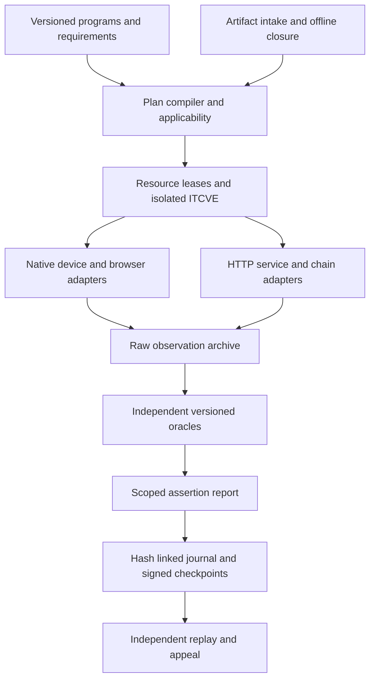

# Laboratory architecture

The orchestration control plane is outside SUT networks. It allocates disposable device guests and service namespaces, stages verified artifacts, restores initial state, drives public interfaces, records observations, evaluates criteria, and publishes only after evidence verification. Adapters execute lifecycle operations and preserve raw observations. Independent oracles determine conformance.

ITCVE-1 supplies the complete component graph. ISI-1 selects a full integration profile; the other ISIs select smaller closures of that graph. A service can be the SUT in one run and a pinned supporting component in another. The run manifest records each role distinctly. All components are replaceable by an implementation that satisfies the declared interface and admission contract; the coordinator is not tied to an SDK language.

## Boundaries

1. Intake records submitted bytes, source/release provenance when available, license/redistribution terms, signature verification, architecture, configuration, and dependencies.
2. Planning expands required vectors and matrix cells, verifies closure and capabilities, assigns resource leases, and refuses unresolved mandatory interpretations.
3. Execution runs a fixed schedule in isolated regtest environments. Readiness is semantic (expected chain/state), not merely an open port.
4. Observation captures raw protocol and state evidence with causal identifiers before projection.
5. Evaluation uses versioned independent predicates and predeclared applicability.
6. Publication preserves failed and blocked attempts, emits an immutable candidate bundle, and requires review/attestation for official claims.

## Sharing efficiently

The coordinator deduplicates immutable image layers and fixture blobs and reuses OS base snapshots after verified reset. Native device leases are exclusive. Each matrix cell has separate wallet identities, permissions, browser profiles, chain state, and content roots. Shared interoperability topologies form a single recorded run with one event schedule. Resource sharing preserves evidence independence and result scope.

## Implementation strategy

The dependency-free Node core establishes machine-readable contracts and evidence mechanics. Wire protocols and JSON artifacts remain language-neutral. TypeScript and Go adapters can consume the same program definitions, but imported SDK-level vectors are reviewed for licenses, semantics, independent oracles, and complete HTTP/native coverage before being credited. HTTP drivers, regtest orchestration, native automation, and content acquisition are separate modules with their own conformance tests and qualification gates.
