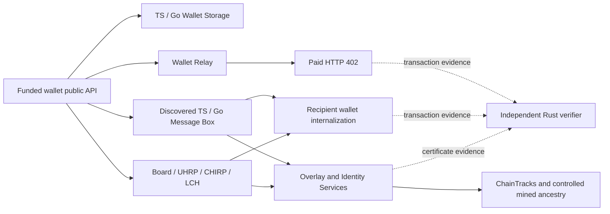

# Integrated laboratory results — November 6, 2026

ITCVE-1 1.3.0 has a verified component evidence pack at source
`56a1de95b01308fee612b80a49bfdf1b034a2d66`. [Foundation run
42312093738](https://github.com/p2ppsr/interop/actions/runs/42312093738)
completed all three jobs. Its eight component lanes contain 22 isolated
executions and **510 assertions: 504 PASS, six FAIL, zero BLOCKED**. The six
failures are three unchanged upstream Go Message Box findings reproduced twice.
The separately identified Go compatibility participant passes its complete
contract. This pack issues `INFRASTRUCTURE_QUALIFICATION_ONLY`.

The [integrated native run](https://github.com/p2ppsr/interop/actions/runs/42312095022)
qualifies two fresh unchanged Yours Wallet 5.1.0 identities on the same frozen
source: **154/154 integration assertions and 96/96 independent Rust assertions
PASS**. The earlier
[all-Go native qualification](../journals/native-wallet-qualification/2026-11-06/yours-wallet-5.1.0-all-go/qualification.json)
remains unchanged: Yours Wallet 5.1.0 has four PASS, two FAIL and two BLOCKED
ToDo vectors in both repetitions. The new component results do not replace those
findings or establish full BRC-100 conformance or certification.

The [frozen profile](../itcves/ITCVE-1/1.3.0/profile.json) and
[implementation description](../itcves/ITCVE-1/1.3.0/README.md) bind the component
versions, dependencies, adapters, oracles and repetitions. The joined design is:



Component runs exercise reference wallets and real services. The separate native
driver connects the unchanged wallet's public CWI API to this graph; its
Board/UHRP/CHIRP/LCH path and temporary trusted-issuer configuration are covered
by the independently verified native pack below.

| Component lane | Isolated executions | Assertions | PASS | FAIL | Evaluated operations |
| --- | ---: | ---: | ---: | ---: | --- |
| Storage synchronization | 8 | 88 | 88 | 0 | TS→TS, TS→Go, Go→TS and Go→Go twice; interruption, resume, incremental changes, replacement, relationships, metadata, proof integrity and identity isolation |
| Overlay and identity | 2 | 28 | 28 | 0 | Actual TS/Go overlay engines; bidirectional GASP, new outpoints, conflicting spends, persistence, SHIP/SLAP, ChainTracks reorg, certificates, selective disclosure and relinquishment |
| Messaging | 2 | 82 | 76 | 6 | Discovery, authenticated ownership, encrypted paid delivery, exact receipt, acknowledgment, replay, restart and push delivery |
| Transport with TS storage | 2 | 34 | 34 | 0 | Relay pairing, origin/session/permission controls, cryptographic operations, reconnect/revocation and paid HTTP acceptance/rejection |
| Transport with Go storage | 2 | 34 | 34 | 0 | The same relay and paid HTTP contract using Go storage |
| Wallet boundary with TS storage | 2 | 86 | 86 | 0 | All 28 BRC-100 methods and explicit negative cases, including real Identity Services and a controlled trusted issuer |
| Wallet boundary with Go storage | 2 | 86 | 86 | 0 | The same boundary corpus using Go storage |
| Rust independent checks | 2 | 72 | 72 | 0 | Cross-language keys/signatures, strict Atomic BEEF, mined ancestry, scripts, value conservation, certificate vectors and modified-payment rejection |
| **Total** | **22** | **510** | **504** | **6** | **15 top-level lane results; storage aggregates its eight cells** |

The [machine-readable qualification](../journals/integrated-component-qualification/2026-11-06/42312093738/qualification.json)
records every lane, repetition, exit code and finding. No lane timed out. The
assertion total excludes unit tests and the separate mixed Go-component matrix.

Each messaging repetition reports TS **14/14 PASS**, adapted Go **14/14 PASS**,
and unchanged Go **10 PASS / 3 FAIL**. The upstream findings are:

| Unchanged Go predicate | Observed defect | Explicit compatibility behavior |
| --- | --- | --- |
| `paid-internalization` | Go byte slices serialize as base64 strings where the BRC-100 client requires numeric byte arrays | Normalize payment transaction bytes before response authentication |
| `payment-replay-rejected` | A previously accepted payment can be submitted again | Atomically claim the transaction ID and recipient in persistent SQLite |
| `payment-replay-after-acknowledgment` | Acknowledgment removes the message without retaining a replay claim | Preserve the payment claim independently of message acknowledgment and restart |

Go's upstream native WebSocket capability remains absent. The declared adapter
uses the actual TS AuthSocket transport, the Go server identity and its existing
SQLite state; the authenticated socket owner determines the read filter. Go HTTP
continues to perform writes and acknowledgment. The adapter's ownership,
pagination, reconnect, restart and duplicate-delivery checks pass. HTTP polling
coverage remains separate. No native Go WebSocket or FCM result is issued.

All three Foundation jobs succeeded. `offline-core` passed 75 repository tests,
50 synthesis tests (eight skipped), five Python packaging tests, contract checks,
standards qualification, synthesis typecheck, demo verification and journal
history checks. The synthesis dependency audit reported zero vulnerabilities. `go-components` passed all eight mixed service combinations and
their fault/recovery checks. `integrated-components` passed dependency preparation,
three transport, 13 service and one Rust regression tests, repeated execution,
independent child oracles,
published-archive semantic verification and messaging/Rust tamper tests. Exact
step outcomes are retained in [jobs.json](../journals/integrated-component-qualification/2026-11-06/42312093738/jobs.json);
[the original log ZIP](../journals/integrated-component-qualification/2026-11-06/42312093738/foundation-logs.zip)
contains every job's logs.

The retained [original GitHub artifact](../journals/integrated-component-qualification/2026-11-06/42312093738/integrated-lab.zip)
is 1,832,015 bytes, SHA-256
`9bed5f9c354301132991cd167aa9bdee6080f13f857318fc3e497884aac0a41f`.
That digest matches GitHub's receipt. [Provenance](../journals/integrated-component-qualification/2026-11-06/42312093738/provenance.json)
binds the artifact, raw API receipts, logs, qualification and independent
verification. Local macOS/arm64 verification with the same frozen component code
re-ran every child oracle; all original ZIP members remained byte-identical.
The published verifier checks complete inventories and digests, bounded safe ZIP
extraction, frozen inputs, exact lane counts and the underlying semantic oracles.

Earlier successful component packs [42304588035](../journals/integrated-component-qualification/2026-11-06/42304588035/README.md),
[42305420953](../journals/integrated-component-qualification/2026-11-06/42305420953/README.md)
and [42309037195](../journals/integrated-component-qualification/2026-11-06/42309037195/README.md)
remain independently retained at their own source revisions. Failed native
attempts remain separate:

| Native run | Recorded classification | Observed boundary and recovery |
| --- | --- | --- |
| [42304592193](../journals/integrated-native-attempts/2026-11-06/42304592193/attempt.json) | `OBSERVER_BUILD_ERROR` | Missing build tools prevented the image build; no wallet executed. The integrated image gained the required compiler tools. |
| [42305419944](../journals/integrated-native-attempts/2026-11-06/42305419944/attempt.json) | `OBSERVER_VERIFICATION_ERROR` | Two repetitions recorded 69 integration predicates each, but Message Box hashes used JSON insertion order while the outer evidence bundle sorted keys. The baseline environment verified; the integrated pack did not. Canonical evidence v2 and an actual EvidenceBundle regression address the observer defect. |
| [42309035783](../journals/integrated-native-attempts/2026-11-06/42309035783/attempt.json) | `OBSERVER_EXECUTION_ERROR` | The first repetition recorded 69 passing component predicates, including all 42 boundary predicates and positive trusted discovery, then rejected an undefined optional argument during evidence serialization. No complete repetition or qualification resulted. The original ZIP, all logs and cleanup evidence are retained; a fresh native run is required. |

The [native qualification](../journals/integrated-native-qualification/2026-11-06/42312095022/qualification.json)
records `qualifiedEnvironment: true`, matching repetition projections and an
integrated outcome of `PASS`, with the baseline wallet outcome separately `FAIL`.
Each fresh identity passes 17 relay/payment predicates, six Message Box predicates,
four synthesis predicates, 42 boundary predicates and eight public-settings trust
predicates: 77 per repetition. Rust independently passes 48 checks per repetition,
including the temporary settings-token creation and retirement transactions.

Both measured trust-cache waits are 121000 milliseconds. The initially absent
settings token is created through public wallet calls and then spent; the original
settings and empty basket are restored. Two separate reference preflights also
cover restoration when an original settings token exists. Native admission
verifies exact artifacts, Chromium sandbox, controlled CA trust, kernel network
isolation, mined funding ancestry and terminal cleanup. The original ToDo vectors
remain V001–V004 PASS, V005–V006 FAIL and V007–V008 BLOCKED in both repetitions.

The [original native ZIP](../journals/integrated-native-qualification/2026-11-06/42312095022/native-integrated.zip)
is 889,156 bytes, SHA-256
`0d0dd31ee9df2e513ac51fc4a17537f3f3343c94083b70327ad363fed0fab844`, matching
GitHub's artifact receipt. The archive retains all job logs, raw API receipts,
the exact qualification and independent verification. Local replay checks every
native child oracle and Rust result; all original ZIP members remain unchanged.
Runtime, pins and oracles were frozen at
`56a1de95b01308fee612b80a49bfdf1b034a2d66` before execution. Later publication
commits add evidence and documentation only. Partial observations from earlier
attempts remain unqualified.

To execute a new component pack, use Node 24.22.1, Go 1.27.3 and Rust 1.88.0 on
clean committed source. Preparation downloads pinned inputs. Execution needs
disposable loopback MongoDB and local SQLite; each output directory must be new.

```sh
npm ci --ignore-scripts --prefix synthesis
npm ci --ignore-scripts --prefix components/transport
npm ci --ignore-scripts --prefix integrations/services
npm rebuild better-sqlite3 --prefix integrations/services
rustup toolchain install 1.88.0 --profile minimal
npm run prepare:go
node scripts/prepare-storage-sync-go.mjs
node scripts/prepare-messaging.mjs
RUSTUP_TOOLCHAIN=1.88.0 node scripts/run-integrated-lab.mjs out/integrated-new
RUSTUP_TOOLCHAIN=1.88.0 node scripts/verify-integrated-lab.mjs out/integrated-new
```

With those dependencies prepared, retained packs can be verified without starting
services. This command checks all published integration archives and re-executes
their semantic oracles; failed-attempt manifests receive integrity checks only:

```sh
RUSTUP_TOOLCHAIN=1.88.0 node scripts/verify-published-integrations.mjs --semantic
```

The native variants use the Linux/amd64
[wallet workflow](../.github/workflows/isi4-yours-wallet.yml). Select
`integrated-native-trusted` for the separate trusted-issuer plan. It uses the
unchanged wallet's public settings-token API, waits for the native trust-cache
expiry, and restores the original durable settings. It does not alter private
wallet objects, trust caches or clocks. Native execution requires its own frozen
artifact preparation and isolated image; the component command above is not a
native qualification command.

The remaining scope is explicit. Method execution does not cover every BRC-100
clause. V007 native portability, full V008, other native wallets and mixed native
service combinations retain separate admission gates. Protocol-driven application
operations do not qualify packaged Board UI, native Send/Receive, PeerPay,
Mountaintops, physical phones, cameras or push-notification platforms. Local
SQLite durability does not establish production distributed-database availability.

Temporary processes, databases and identities are owned and retired per run.
Compatibility code remains bounded to the declared lab profile: Go payment and
push adapters, storage wire/metadata/keyring fixes, GASP compatibility and LCH
derivation conversion. An adapter retires only after an upstream replacement
passes the same frozen predicates and fresh repetitions. Rollback selects the
earlier frozen ITCVE-1 1.1.0 or 1.2.0 profile; historical journals remain intact.
No public service migration, production credential use, public-mainnet spending
or paid device expansion is part of this pack. Operator, owned-capacity and agent
costs remain unmeasured; no zero-cost or efficiency-improvement claim is issued.
